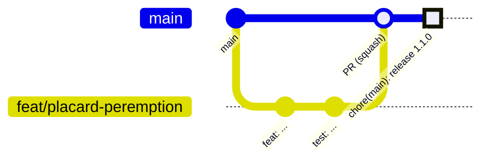

# Contribuer

Le processus est volontairement **professionnel mais léger** : une branche principale
protégée, des pull requests vérifiées automatiquement, des versions générées à partir des
messages de commit.

## Flux de travail

1. Créer une branche depuis `main` : `feat/…`, `fix/…`, `docs/…`, `recette/…`.
2. Développer avec des commits au format
   [Conventional Commits](https://www.conventionalcommits.org/fr/) :
    - `feat: ajouter les allergies par membre` → nouvelle version mineure ;
    - `fix: arrondi des œufs par boîte de 6` → version corrective ;
    - `docs:`, `test:`, `refactor:`, `chore:`, `ci:` → pas de nouvelle version ;
    - `feat!:` ou `BREAKING CHANGE:` → version majeure.
3. Vérifier localement : `uv run poe check` (backend) et
   `npm run lint && npm run check && npm test` (interface). Les hooks
   `uvx pre-commit install` font une partie de ces contrôles à chaque commit, et
   [gitleaks](https://github.com/gitleaks/gitleaks) y refuse tout commit contenant un
   secret (jeton, clé privée, mot de passe).
   Pour une modification de l'interface, lancer aussi les **parcours de bout en bout**
   (connexion et ajout d'un membre, génération d'une semaine et fiche d'un plat, liste de
   courses et export PDF) : `cd frontend && npx playwright install chromium` une fois,
   puis `npm run e2e`. L'interface est compilée puis servie par l'API sur le port 8020,
   avec une base neuve, une date figée et tout site externe bloqué.
4. Ouvrir une **pull request** : la CI doit passer (style, types, tests, couverture ≥ 90 %,
   parcours de bout en bout, audit des dépendances, compilation de l'interface, de la documentation et de l'image Docker, absence de
   secret dans tout l'historique).
5. **Fusion en squash** : le titre de la PR devient le message de commit sur `main`.

## Versions

[release-please](https://github.com/googleapis/release-please) tient à jour une PR
« chore(main): release x.y.z » qui accumule le `CHANGELOG.md`. La fusionner crée le tag, la
release GitHub et publie l'image Docker versionnée sur `ghcr.io`.

release-please s'authentifie avec une **GitHub App** personnelle (« robot de publication »)
installée sur le dépôt, avec les permissions *Contents*, *Pull requests* et *Issues* en
lecture/écriture. Le workflow en obtient un jeton valable une heure
(`actions/create-github-app-token`) grâce à :

- la variable de dépôt `RELEASE_APP_ID` (identifiant de l'App) ;
- le secret `RELEASE_APP_PRIVATE_KEY` (clé privée `.pem` de l'App).

Pourquoi : GitHub ne lance pas la CI sur une PR créée par le jeton automatique des
Actions ; avec l'App, la PR de version est vérifiée normalement, et ses commits sont signés
par le robot de l'App (aucune adresse personnelle). Sans App configurée, le workflow se replie
sur le jeton automatique : il faut alors fermer et rouvrir la PR de version pour lancer la CI.

## Automatisations

| Workflow | Déclencheur | Rôle |
|---|---|---|
| `ci.yml` | chaque PR et `main` | qualité, tests, image Docker (publiée depuis `main`) |
| `release.yml` | `main` | versions et changelog |
| `docs.yml` | `main` (dossier `docs/`) | publication de cette documentation |
| `donnees.yml` | le 1er du mois | mise à jour des données ouvertes (PR automatique) |
| Dependabot | mensuel | mises à jour groupées des dépendances |

## Conventions de code

- **Python** : ruff (style et import), pyright (types), pytest. Noms en français, docstrings
  qui expliquent le *pourquoi*, fonctions courtes.
- **Interface** : Svelte 5 (runes), TypeScript strict, Prettier.
- Les **décisions d'architecture** importantes sont consignées dans `docs/adr/`.

## Ajouter une recette

Voir le [format du catalogue](technique/catalogue.md). Les tests garantissent que la
recette est cohérente (ingrédients connus, énergie plausible, saisonnalité).
