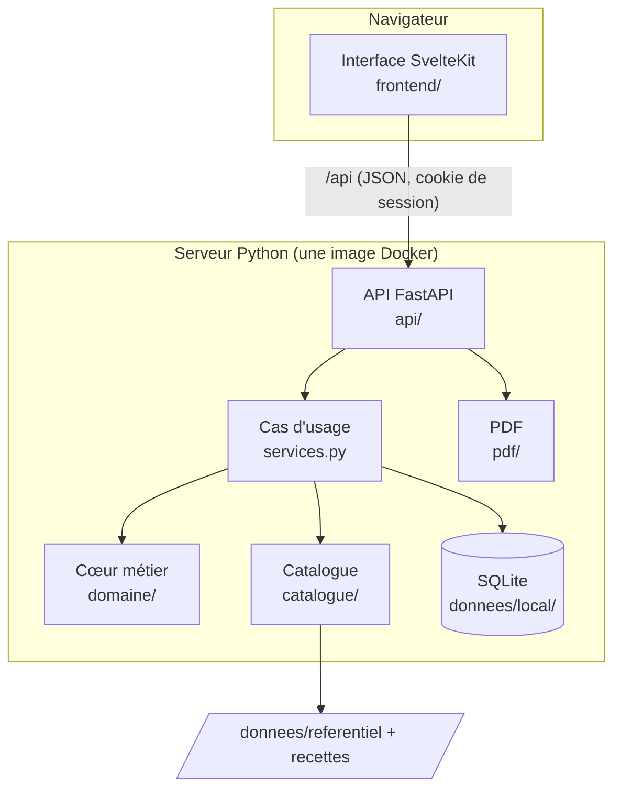

# Architecture

## Principes

- **Cœur métier pur** : `domaine/` ne dépend ni de la base ni du web. Les besoins,
  l'algorithme, le bilan et les courses se testent avec de simples objets Python.
- **Catalogue en fichiers, données de la famille en base** : les recettes et ingrédients sont
  versionnés et relus (Git) ; la base SQLite ne contient que les membres, semaines, notes,
  placard et réglages.
- **Un seul processus** : FastAPI sert l'API et, en production, l'interface compilée. Pas de
  serveur web séparé ni de file de tâches : CP-SAT répond en quelques secondes.
- **Lisibilité** : noms en français, docstrings expliquant le *pourquoi*, typage complet
  (pyright, TypeScript strict).

## Backend — `backend/src/repas/`

| Module | Rôle |
|---|---|
| `config.py` | Paramètres (variables `REPAS_*`) |
| `catalogue/schemas.py` | Modèles Pydantic : ingrédients, données ouvertes, recettes |
| `catalogue/chargement.py` | Chargement, validation et profils des recettes |
| `catalogue/import_recettes.py` | Import JSON et fichier d'instructions pour IA |
| `domaine/besoins.py` | Besoins énergétiques (Henry) et coefficients de portion |
| `domaine/reperes.py` | Repères ANSES / PNNS |
| `domaine/notes.py` | Préférences (moyenne bayésienne) |
| `domaine/planificateur.py` | Modèle d'optimisation CP-SAT |
| `domaine/bilan.py` | Bilan nutritionnel et explications |
| `domaine/courses.py` | Liste de courses, conditionnements, placard |
| `modeles.py`, `base.py` | Tables SQLModel et connexion SQLite |
| `services.py` | Cas d'usage (générer, valider les courses...) |
| `api/` | Routes HTTP |
| `pdf/` | Liste de courses et menu en PDF (fpdf2) |
| `import_donnees/` | Import des bases ouvertes |

## Interface — `frontend/src/`

| Dossier | Rôle |
|---|---|
| `routes/` | Pages : semaine (`+page.svelte`), courses, notes, placard, recettes, famille, connexion |
| `lib/composants/` | Composants réutilisables (créneau, bilan, modale, étoiles...) |
| `lib/api.ts` | Client HTTP ; redirection vers la connexion en cas de 401 |
| `lib/types.ts` | Types des réponses de l'API |
| `lib/donnees.svelte.ts` | Membres et recettes partagés entre les pages |
| `lib/dates.ts` | Calcul des semaines (testé) |

L'interface est une application monopage (`adapter-static`), utilisable sur téléphone (barre
de navigation en bas) et installable (manifeste web).

## Sécurité

- Mot de passe unique comparé en temps constant ; session dans un cookie signé
  (`itsdangerous`), `SameSite=Lax`, `Secure` derrière HTTPS.
- Toutes les routes `/api` sauf `/session` et `/sante` exigent la session.
- Imports JSON limités à 2 Mo et validés champ par champ.
- Image Docker exécutée par un utilisateur non privilégié.
