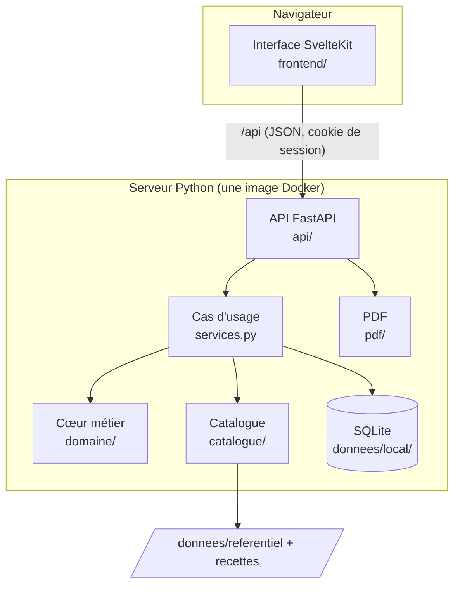

# Architecture

## Principes

- **Cœur métier pur** : `domaine/` ne dépend ni de la base ni du web. Les besoins,
  l'algorithme, le bilan et les courses se testent avec de simples objets Python.
- **Catalogue en fichiers, données de la famille en base** : les recettes et ingrédients sont
  versionnés et relus (Git) ; la base SQLite ne contient que les membres, semaines, notes,
  placard et réglages.
- **Un seul processus** : FastAPI sert l'API et, en production, l'interface compilée. Pas de
  serveur web séparé ni de file de tâches : CP-SAT répond en quelques secondes.
- **Lisibilité** : noms en français, docstrings expliquant le *pourquoi*, typage complet
  (pyright, TypeScript strict).

## Backend — `backend/src/repas/`

| Module | Rôle |
|---|---|
| `config.py` | Paramètres (variables `REPAS_*`) |
| `catalogue/schemas.py` | Modèles Pydantic : ingrédients, données ouvertes, recettes |
| `catalogue/chargement.py` | Chargement, validation et profils des recettes |
| `catalogue/import_recettes.py` | Import JSON et fichier d'instructions pour IA |
| `domaine/besoins.py` | Besoins énergétiques (Henry) et coefficients de portion |
| `domaine/reperes.py` | Repères ANSES / PNNS |
| `domaine/notes.py` | Préférences (moyenne bayésienne) |
| `domaine/planificateur.py` | Modèle d'optimisation CP-SAT |
| `domaine/bilan.py` | Bilan d'une semaine, chiffres clés d'un repas et explications |
| `domaine/nutriscore.py` | Nutri-Score 2023 appliqué à un repas |
| `statistiques.py` | Bilan sur plusieurs semaines (onglet Bilan) |
| `domaine/courses.py` | Liste de courses, conditionnements, placard |
| `domaine/coches.py` | Coches de la liste de courses : la plus récente l'emporte |
| `domaine/articles_libres.py` | Articles libres de la liste (hors repas) : clé de coche, report, total |
| `domaine/placard.py` | Frigo à vider : produits à consommer vite, idées de plats |
| `domaine/produits.py` | Produits scannés : code-barres, fiche Open Food Facts, ingrédients correspondants |
| `open_food_facts.py` | Appel à Open Food Facts pour un produit scanné (ADR 8) |
| `modeles.py`, `base.py` | Tables SQLModel et connexion SQLite |
| `services.py` | Cas d'usage (générer, valider les courses...) |
| `securite.py` | Hachage des mots de passe, limitation des essais de connexion |
| `api/` | Routes HTTP |
| `pdf/` | Liste de courses et menu en PDF (fpdf2) |
| `import_donnees/` | Import des bases ouvertes |

## Interface — `frontend/src/`

| Dossier | Rôle |
|---|---|
| `routes/` | Pages : semaine (`+page.svelte`), courses, notes, placard, recettes (et fiche `recettes/[id]`), famille, connexion |
| `lib/composants/` | Composants réutilisables (créneau, bilan, modale, étoiles...) |
| `lib/api.ts` | Client HTTP ; redirection vers la connexion en cas de 401 |
| `lib/types.ts` | Types des réponses de l'API |
| `lib/donnees.svelte.ts` | Membres et recettes partagés entre les pages |
| `lib/dates.ts` | Calcul des semaines (testé) |
| `lib/coches.ts` | File d'attente des coches de la liste de courses (testé) |
| `lib/hors-ligne.ts` | Règles du service worker : quoi garder, comment (testé) |
| `service-worker/` | Service worker : application et liste de courses sans réseau |

L'interface est une application monopage (`adapter-static`), utilisable sur téléphone (barre
de navigation en bas) et installable (manifeste web, icônes PNG pour Android et iPhone ;
sources dans `frontend/icones/`). Le thème (couleurs claires et sombres, polices Fredoka et
Nunito hébergées dans `static/polices/`) est défini par les variables de `src/app.css`
([ADR 7](../adr/0007-theme-bol-rigolo.md)).

Le service worker ([ADR 6](../adr/0006-hors-ligne.md)) garde dans le cache du navigateur :

| Cache | Contenu | Stratégie |
|---|---|---|
| `menu-famille-application-<version>` | fichiers compilés, icônes, page d'accueil | cache d'abord ; ancienne version supprimée à l'activation |
| `menu-famille-donnees` | `GET /api/session` et `GET /api/semaines/{lundi}/courses` | réseau d'abord, cache sans réseau ; vidé à la déconnexion ou si la session est fermée |

Les navigations passent par le réseau, puis la page d'accueil gardée sans réseau. Le reste de
l'API (écritures, PDF, autres données) n'est jamais intercepté.

## Sécurité

- Comptes adulte / enfant ; mots de passe hachés avec **scrypt** (sel aléatoire, comparaison
  en temps constant) ; blocage d'un identifiant après 5 échecs pendant 1 minute ; session
  dans un cookie signé (`itsdangerous`), `SameSite=Lax`, `Secure` derrière HTTPS.
- Toutes les routes `/api` sauf `/session` et `/sante` exigent une session ; les routes de
  modification, les courses, le placard, le bilan et les comptes exigent un compte adulte
  (dépendance `exiger_adulte`, 403 sinon) ; un enfant ne note que pour lui-même.
- Imports JSON limités à 2 Mo et validés champ par champ.
- Image Docker exécutée par un utilisateur non privilégié.
