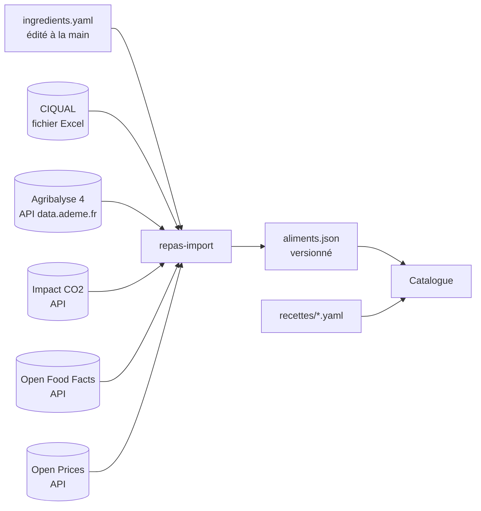

# Données ouvertes

Aucune valeur nutritionnelle, empreinte carbone ou saisonnalité n'est saisie à la main :
tout provient de bases publiques. Seule la **composition des recettes** (ingrédients et
grammages) est éditoriale.

| Donnée | Source | Licence | Lien |
|---|---|---|---|
| Composition nutritionnelle (pour 100 g) | **CIQUAL 2025**, ANSES | Licence ouverte Etalab 2.0 | [ciqual.anses.fr](https://ciqual.anses.fr/) |
| Empreinte carbone (kg CO₂e/kg) | **AGRIBALYSE 4**, ADEME | Licence ouverte Etalab 2.0 | [agribalyse.ademe.fr](https://agribalyse.ademe.fr/) |
| Calendrier des fruits et légumes de saison | **Impact CO2**, ADEME | Licence ouverte | [impactco2.fr](https://impactco2.fr/outils/fruitsetlegumes) |
| Formats de vente (500 g, 1 kg...) | **Open Food Facts** | ODbL | [world.openfoodfacts.org](https://world.openfoodfacts.org/) |
| Prix (médiane des relevés récents) | **Open Prices** | ODbL | [prices.openfoodfacts.org](https://prices.openfoodfacts.org/) |
| Repères nutritionnels | ANSES, Santé publique France (PNNS 4), OMS | — | [mangerbouger.fr](https://www.mangerbouger.fr/) |

## Chaîne de traitement

`uv run repas-import` (module `backend/src/repas/import_donnees/`) :

1. lit le référentiel `donnees/referentiel/ingredients.yaml` ;
2. lit la table **CIQUAL** placée dans `donnees/sources/ciqual/` (fichier Excel officiel ou
   conversion JSON). Sans fichier, il reprend les valeurs du précédent import (la table ne
   change qu'environ une fois par an) ;
3. télécharge **Agribalyse** (indicateur « changement climatique », relié par le code
   CIQUAL), le **calendrier des saisons**, les **formats de vente** les plus fréquents des
   produits vendus en France et la **médiane des prix** récents ;
4. écrit `donnees/referentiel/aliments.json`, **limité aux ingrédients utilisés** : le fichier
   reste petit et ses changements se relisent en revue de code.

Les réponses des API sont mises en cache dans `donnees/sources/` (non versionné) :
`repas-import --hors-ligne` rejoue un import à l'identique.

Un workflow GitHub mensuel (`.github/workflows/donnees.yml`) relance l'import et ouvre une
pull request si les données ont changé.

## Choix et approximations

- **Saisonnalité** : un ingrédient frais porte l'identifiant Impact CO2 correspondant. Les
  légumes de garde (carotte, oignon, ail, échalote), disponibles toute l'année en France, et
  le citron (condiment) n'ont volontairement pas de saison. Conserves, surgelés et produits
  secs sont toujours disponibles.
- **Codes Agribalyse manquants** : quand Agribalyse ne connaît pas un code CIQUAL récent
  (« aliment moyen »), `ciqual_agribalyse` indique un code proche (ex. tomate crue).
- **Formats de vente** : on retient les formats représentant au moins 10 % des produits Open
  Food Facts de la catégorie (au moins 10 produits). Un format saisi à la main
  (`vente.formats`) est prioritaire, par exemple pour le poids égoutté des conserves.
- **Prix** : médiane des 100 derniers relevés en euros (au moins 5), ramenée au kg. Une
  médiane à plus de ×3 ou ÷3 du prix de repli du référentiel est jugée aberrante et ignorée.
- **Sel** : CIQUAL donne le sel des ingrédients crus ; le sel ajouté en cuisine n'est pas
  compté, d'où l'absence de sel dans les recettes et une cible de sel prudente.
- **Part comestible** : les recettes indiquent des poids nets ; les achats sont corrigés par
  `part_comestible` (ex. 0,65 pour la banane).

## Attribution

L'interface et les PDF citent les sources. L'API expose `GET /api/sources`.
Les données dérivées d'Open Food Facts et d'Open Prices (`formats_off`,
`prix_kg_open_prices`) sont sous licence ODbL.
